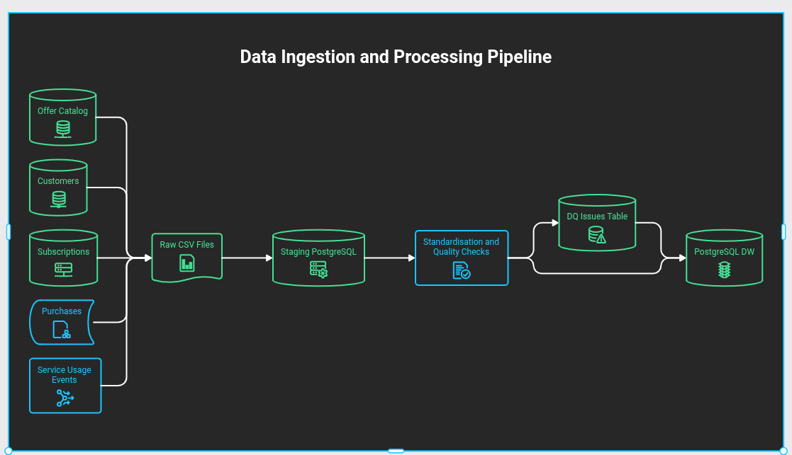
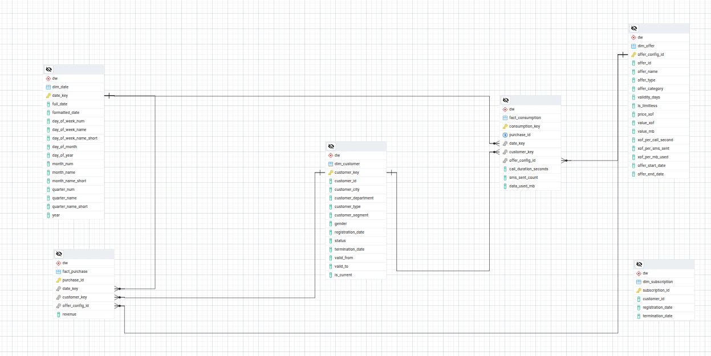

# Telecom Data Platform

## Project Overview

This is a batch-oriented data engineering platform designed to simulate data infrascturcture of a fictional Beninese telecommunications operator.

The platform integrates data from multiple operational systems into a staging area where it performs data quality checks, and consolidates the processed data into a centralized PostgreSQL data warehouse to support business intelligence and analitical use cases.

It handles different data formats and source systems, including relational databases, CSV files, Parquet files, and Kafka event streams consumed in batches.

The platform uses Python and Apache Airflow to manage and orchestrate batch workflows, PostgreSQL and SQL for data extraction from relational source systems, and processing, psql to execute database operations, and DuckDB to extract data from Parquet files.

## Table of Contents

- [Project Overview](#project-overview)
- [Business Context and Objectives](#business-context-and-objectives)
- [Data Architecture](#data-architecture)
- [Technology Stack](#technology-stack)
- [Data Sources](#data-sources)
- [Data Pipeline](#data-pipeline)
- [Data Warehouse](#data-warehouse)
- [Pipeline Orchestration](#pipeline-orchestration)
- [Analytical Use Cases](#analytical-use-cases)
- [Project Structure](#project-structure)
- [Installation and Execution](#installation-and-execution)
- [Future Improvements](#future-improvements)

## Business Context and Objectives

[Business Requirements](./docs/01_business_requirements/business_requirements.md)

## Data Architecture and Technology Stack

### Data Architecture

The platform follows a batch-oriented data architecture:

Data Sources → Extraction → Raw Layer → Staging Layer → Data Quality Checks → Data Warehouse → Analytics

Apache Airflow orchestrates the different stages of the data pipelines.

### Technology Stack

| Technology | Purpose |
-------------|------------
Python | Implements ingestion scripts, manages files, consumes Kafka events in batches and executes PostgreSQL commands.
PostgreSQL| Stores Raw and Staging data, data quality issues and the Data Warehouse.
psql| Executes SQL commands for database extraction into the Raw layer as CSV, Raw-to-Staging transfers, data quality checks, transformations and warehouse loading.
DuckDB| Reads Parquet files and extracts purchase data into the Raw layer as CSV files.
Apache Kafka| Provides service usage events consumed periodically in batches.
Apache Airflow| Orchestrates batch workflows, manages task dependencies, retries and failures.
SQL| Implements extraction, data quality checks, transformations and loading operations.

See [Architecture and Technology Decisions](./docs/03_architecture/architecture_and_tech_decisions.md ) for a detailed explanation of the architecture and technology choices.

## Data Sources

Source System| Data| Source Format
-------------|------------|-------
CRM| Customer information| PostgreSQL
Subscription Management System| Mobile subscription information| PostgreSQL
Offer Management System| Telecom offer catalogue| PostgreSQL
Transaction Management System| Offer purchases | Parquet
Usage Mediation System| Data, voice and SMS usage events| Kafka

## Data Pipeline

The data pipeline is organized into the following stages:

### Data Extraction

Data is extracted into the Raw layer as CSV files, using different tools depending on the source:

- PostgreSQL sources are extracted using SQL commands executed through "psql", with the extracted data exported to CSV files in the Raw layer.
- Parquet purchase files are read using DuckDB and exported to CSV files in the Raw layer.
- Service usage events are consumed in batches from Kafka into the Raw layer using a Python Kafka consumer

### Raw Layer

The Raw layer stores extracted data before further processing.

It preserves the original source data and associates records or files with the identifier of the current batch.
Data in the Raw Layer is organized by date and by batch identifier.

### Staging Layer

Raw data is transferred into PostgreSQL staging tables using psql \copy command.

The Staging layer provides an intermediate area for data quality checks and preparation before warehouse loading.

### Data Quality

SQL-based data quality checks are executed in PostgreSQL through "psql".

The checks cover:

- Completeness.
- Validity.
- Consistency.
- Uniqueness.
- Referential integrity.

Quality results and data acceptance or rejection decisions are tracked using via PostgreSQL table.

### Data Transformation and Loading

Data transformations and warehouse loading are implemented using SQL queries executed through "psql".

The processes include data standardization, handling of missing or invalid values, derivation of analytical attributes, aggregation of service consumption, and initial and incremental loading.

## Data Warehouse

The platform uses a PostgreSQL dimensional data warehouse based on a star schema.

The model includes fact tables for telecom offer purchases and service consumption, supported by dimensions such as date, customer, subscription and offer.

The loading processes implement appropriate Slowly Changing Dimension (SCD) strategies to manage dimension updates and preserve relevant historical information.

## Pipeline Orchestration

Apache Airflow orchestrates the batch data pipelines.

The orchestration layer manages:

- Task dependencies and execution order.
- Initial and incremental pipeline runs.
- Batch tracking.
- Task retries and failure handling.
- Pipeline execution status and recovery.

## Analytical Use Cases

The Data Warehouse supports analytical use cases such as:

- Customer distribution by region and segment.
- Telecom offer performance and adoption.
- Offer purchase trends.
- Daily and monthly data, voice and SMS consumption.
- Customer purchasing and consumption behaviour.

## Project Structure

## Installation and Execution

## Future Improvements

Potential improvements include:

- Expanding analytical use cases.
- Adding automated data pipeline tests.
- Improving pipeline monitoring and observability.
- Developing business intelligence dashboards.