# Telecom Data Platform

## Project Overview

This is a batch-oriented data engineering platform designed to simulate data infrascturcture of a fictional Beninese telecommunications operator.

The platform integrates data from multiple operational systems into a staging area where it performs data quality checks, and consolidates the processed data into a centralized PostgreSQL data warehouse to support business intelligence and analitical use cases.

It handles different data formats and source systems, including relational databases, CSV files, Parquet files, and Kafka event streams consumed in batches.

The platform uses Python and Apache Airflow to manage and orchestrate batch workflows, PostgreSQL and SQL for data extraction from relational source systems, and processing, psql to execute database operations, and DuckDB to extract data from Parquet files.

## Table of Contents

- [Project Overview](#project-overview)
- [Business Context and Objectives](#business-context-and-objectives)
- [Architecture and Technology Stack](#architecture-and-technology-stack)
- [Data Sources](#data-sources)
- [Data Pipeline](#data-pipeline)
- [Data Warehouse](#data-warehouse)
- [Analytics and Dashboards](#analytics-and-dashboards)
- [Pipeline Orchestration](#pipeline-orchestration)
- [Project Structure](#project-structure)
- [Installation and Execution](#installation-and-execution)
- [Future Improvements](#future-improvements)

## Business Context and Objectives

### Business Context

This project is based on a fictional telecommunications operator in Benin. The operator generates data multiple business systems, including CRM, subscriptions, telecom offers, purchases and service usage.

Bringing these data sources together provides a foundation for monitoring business performance, understanding customer behaviour, and supporting data-driven decision-making.

### Project Objectives

The main objective is to build a centralized data platform that transform data from heteregeneous sources into reliable, structured, and actionable information.

The platform aims to support business analysis in the following areas:
- Telecom offer performance and adequacy
- Revenue distribution accross customer segments
- Regional business growth
- Customer activity and engagement

The detailed business requirements and analytical questions are documented here: [Business Requirements](./docs/01_business_requirements/business_requirements.md)

## Architecture and Technology Stack

### Data Platform Architecture

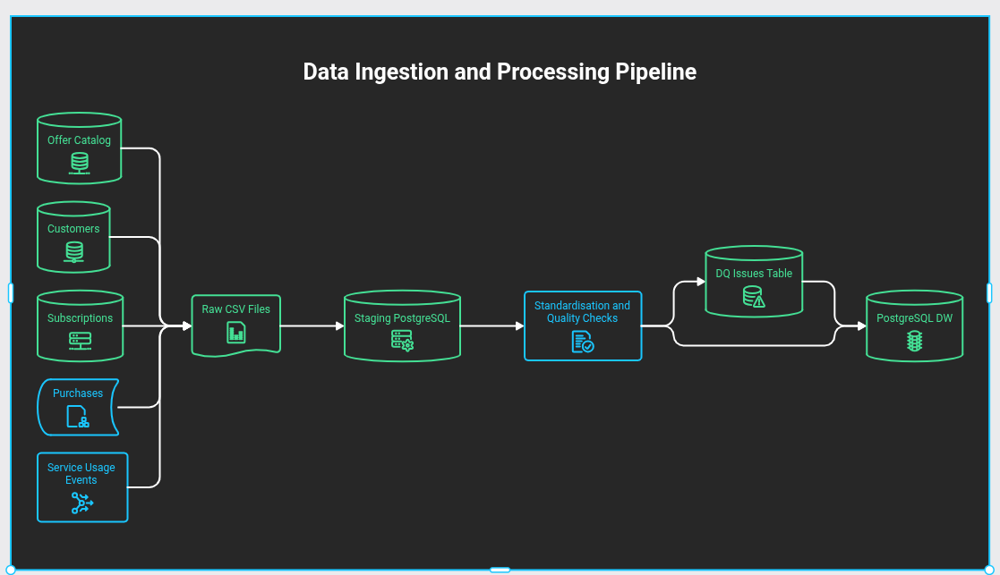

The platform follows a batch-oriented data architecture:

Data Sources → Extraction → Raw → Staging → Data Quality Checks → Data Warehouse → Analytics → Busines Intelligence

Apache Airflow orchestrates the different stages of the data pipeline.

### Technology Stack

| Technology | Purpose |
-------------|------------
Python | Implements ingestion scripts, manages files, consumes Kafka events in batches and executes PostgreSQL commands and files.
PostgreSQL| Stores Raw and Staging data, data quality issues, the Data Warehouse.
psql| Executes SQL commands for database extraction into the Raw layer as CSV, Raw-to-Staging transfers, data quality checks, transformations and warehouse loading.
DuckDB| Reads Parquet files and extracts purchase data into the Raw layer as CSV files.
SQL| Implements extraction, data quality checks, transformations and loading operations.
Apache Kafka| Provides service usage events consumed periodically in batches.
Apache Airflow| Orchestrates batch workflows, manages task dependencies, retries and failures.
Apache Superset| ....

See [Architecture and Technology Decisions](./docs/03_architecture/architecture_and_tech_decisions.md ) for a detailed explanation of the architecture and technology choices.

## Data Sources

Source System| Data| Source Format
-------------|------------|-------
CRM| Customer information| PostgreSQL
Subscription Management System| Mobile subscription information| PostgreSQL
Offer Management System| Telecom offer catalogue| PostgreSQL
Transaction Management System| Offer purchases | Parquet
Usage Mediation System| DATA, CALL and SMS usage events| Kafka

## Data Pipeline

The data pipeline is organized into the following stages:

### Data Extraction

Data is extracted into the Raw layer as CSV files, using different tools depending on the source:

- PostgreSQL sources are extracted using SQL commands executed through "psql", with the extracted data exported to CSV files in the Raw layer.
- Parquet purchase files are read using DuckDB and exported to CSV files in the Raw layer.
- Service usage events are consumed in batches from Kafka into the Raw layer using a Python Kafka consumer

### Raw Layer

The Raw layer stores extracted data before further processing.

It preserves the original source data and associates records or files with the identifier of the current batch.
Data in the Raw Layer is organized by date and by batch identifier.

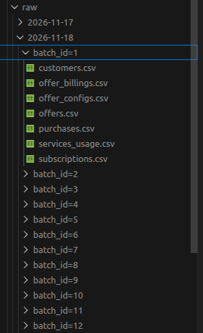

### Staging Layer

Raw data is transferred into PostgreSQL staging tables using psql \copy command.

The Staging layer provides an intermediate area for data quality checks and preparation before warehouse loading.

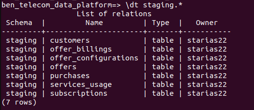

### Data Quality

SQL-based data quality checks are executed in PostgreSQL through "psql".

The checks cover:

- Completeness.
- Validity.
- Consistency.
- Uniqueness.
- Referential integrity.

Quality results and data acceptance or rejection decisions are tracked using PostgreSQL table.

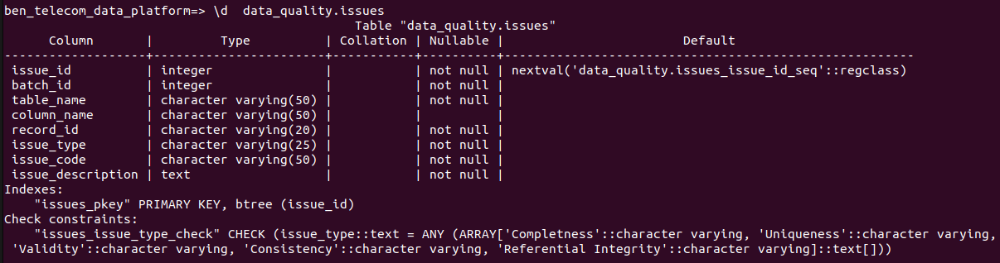

### Data Transformation and Loading

Data transformations and warehouse loading are implemented using SQL queries executed through "psql".

The processes include data standardization, handling of missing or invalid values, derivation of analytical attributes, aggregation of service consumption by consumption date, and initial or incremental loading.

## Data Warehouse

The platform uses a PostgreSQL dimensional data warehouse.

The model includes fact tables for telecom offer purchases and service consumption, supported by dimensions such as date, customer, subscription and offer.

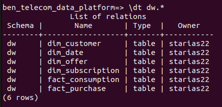

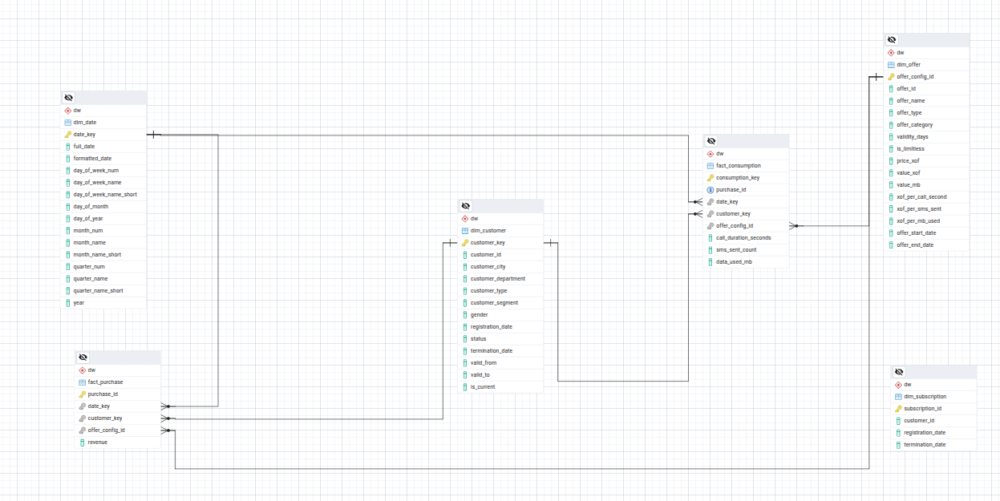

The loading processes implement appropriate Slowly Changing Dimension (SCD) strategies to manage dimension updates and preserve relevant historical information.

## Analytics and Dashboards

### PostgreSQL Analytics Layer

A dedicated PostgreSQL analytics layer was developed to provide simplified, business-oriented access to the data warehouse for business intelligence and reporting.

It consists of:

- **Standard views** to organise and expose data from the data warehouse.
- **Materialised views** to store precomputed analytical results and improve query performance.
- **Analytical tables** to store prepared datasets for specific business analyses.

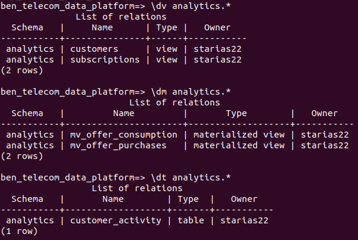

This layer centralises data access logic, reduces repetitive complex joins in BI queries, and provides structured datasets for dashboard development.

Following successful data warehouse loads, the pipeline regularly refreshes the relevant analytical objects to keep reporting data up to date.

### Superset Dashboards

Five interactive dashboards were developed using Apache Superset to address the project's main business analysis requirements.

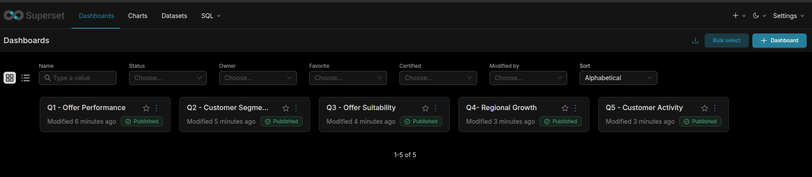

#### 1. Offer Performance

Evaluates the commercial and financial performance of telecom offers at different levels of the offer hierarchy: individual offers, offer categories, and offer families. It helps identify the offers contributing most to revenue and customer adoption.

**Offer-Level Analysis**

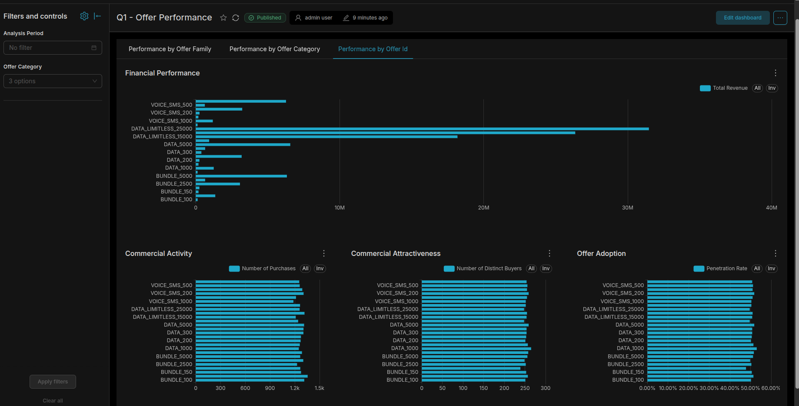

**Offer Category Analysis**

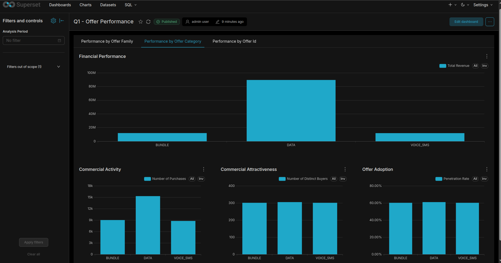

**Offer Family Analysis**

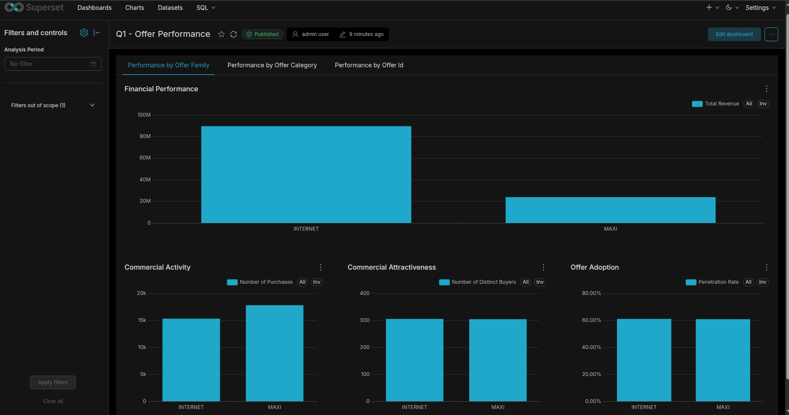

---

#### 2. Segment Revenue

Analyses revenue contribution across customer segments and compares their financial performance.

**Revenue Analysis by Customer Segment**

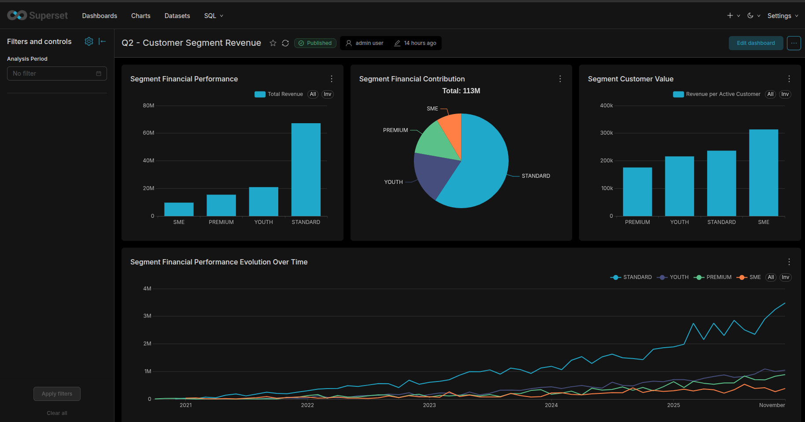

---

#### 3. Offer Suitability Analysis

Evaluates how well telecom offers align with customer consumption patterns by analysing the utilisation of allocated benefits, including mobile data, voice calls, and SMS. Consumption rates help identify whether customers fully utilise their allocated benefits or leave a significant portion unused.

**Offer-Level Analysis**

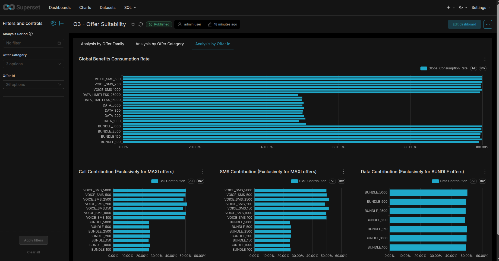

**Offer Category Analysis**

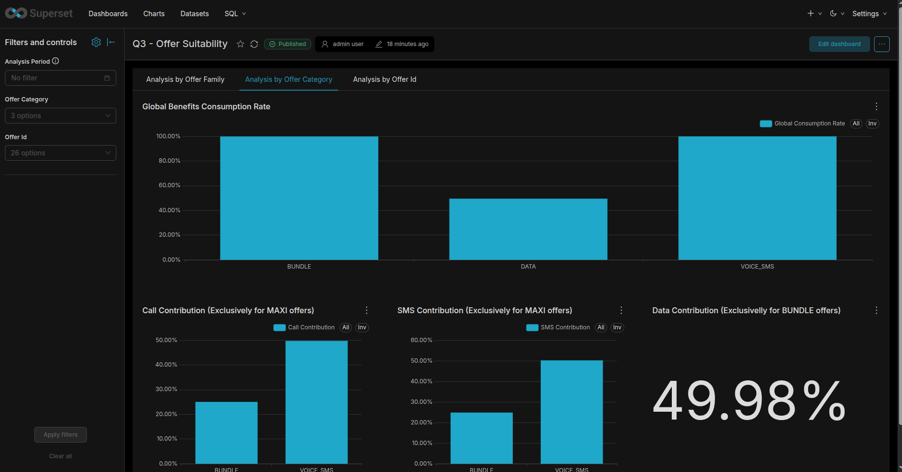

**Offer Family Analysis**

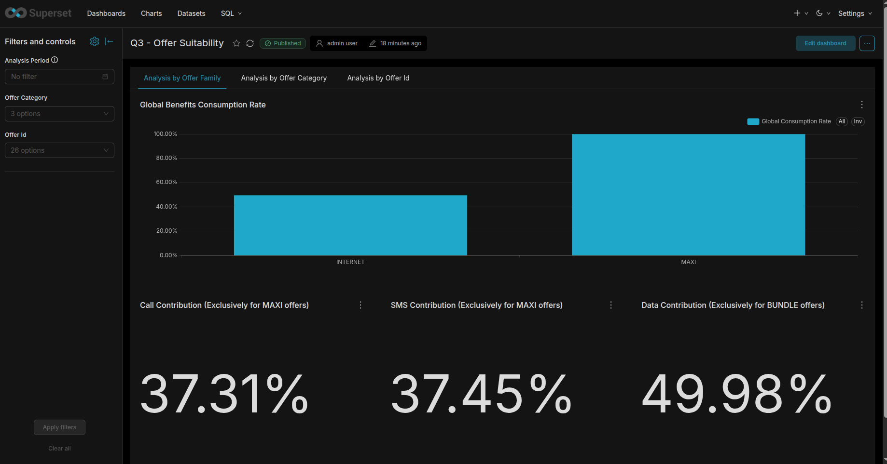

---

#### 4. Regional Growth

Tracks changes in customer activity and commercial performance across regions and cities. It compares reporting periods to highlight regional growth patterns.

**Active Customer Growth by Region**

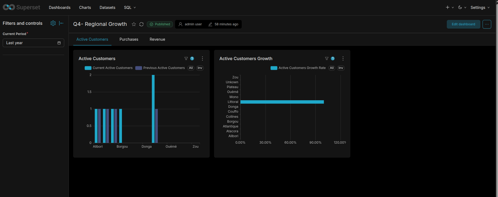

**Purchase Growth by Region**

**Revenue Growth by Region**

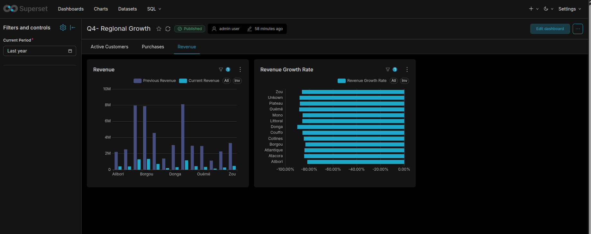

---

#### 5. Customer Activity

Provides insights into customer engagement by presenting an overall activity overview, analysing the distribution of activity statuses, and providing detailed customer-level information.

**Activity Overview**

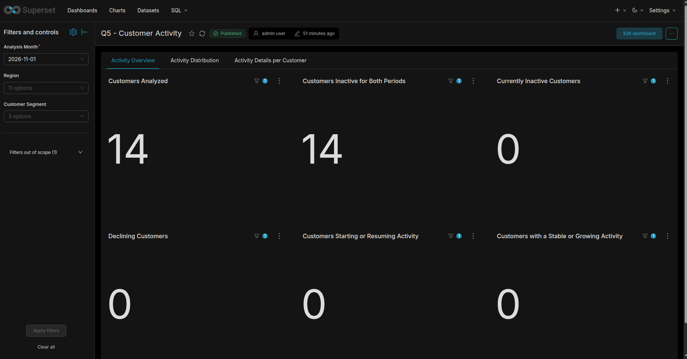

**Activity Distribution**

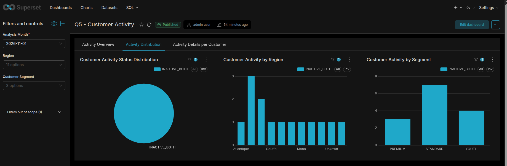

**Activity Details**
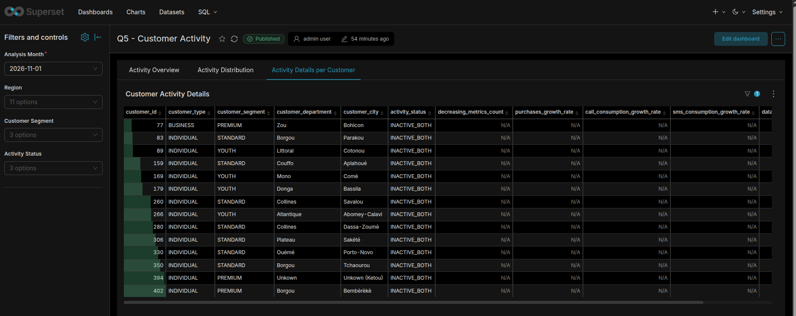

---

### Dashboard Features

The dashboards provide interactive analytical capabilities, including:

- **Interactive filtering:** exploring data by reporting period and relevant business dimensions, depending on the dashboard.
- **KPI monitoring:** tracking key commercial, financial, consumption, and customer activity indicators.
- **Period comparisons:** examining changes and growth between selected reporting periods.
- **Multi-level analysis:** exploring offer performance at offer, category, and family levels, as well as regional and customer-segment performance.

Together, the PostgreSQL analytics layer and Superset dashboards transform integrated telecom data into actionable business insights, supporting performance monitoring and data-driven decision-making.

## Pipeline Orchestration

Apache Airflow orchestrates the batch data pipelines.

The orchestration layer manages:

- Task dependencies and execution order.
- Initial and incremental pipeline runs.
- Batch tracking.
- Task retries and failure handling.
- Pipeline execution status and recovery.

## Project Structure

## Installation and Execution

## Future Improvements

Potential improvements include:

- Adding automated data pipeline tests.
- Improving pipeline monitoring and observability.
